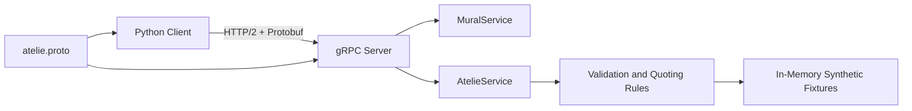
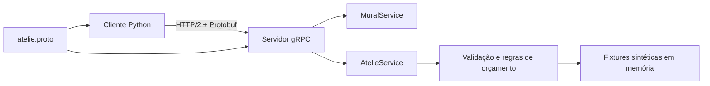

# Distributed Ateliê with gRPC

[](https://www.python.org/)
[](https://grpc.io/)
[](https://github.com/edusotho32/distributed-atelie-grpc/actions/workflows/ci.yml)

> 🌐 **Language / Idioma:** English | [Versão em Português](#-versão-em-português)

An academic case study exposing order quoting rules and service order queries via typed RPC. The technical focus is demonstrating the boundary between protocol contracts (`.proto`), server-side validation, Protocol Buffers serialization, and a real end-to-end client-server integration test.

> All records are synthetic. The public version contains no personal data, credentials, embedded runtimes, or third-party Java sources.

## Engineering Problem

The original prototype mixed source code, heavy runtimes, and sample data that resembled personal information. This version isolates the distributed core and makes three behaviors verifiable: stable contracts, deterministic business rules, and explicit gRPC status errors for invalid inputs.



## Demonstrated Rules

- 10% discount when an order contains at least five garments.
- 25% express fee applied after discount.
- Express deadline cut in half, with a minimum of one day.
- Explicit rejection of non-existent services and non-positive quantities.
- Mural counter protected by concurrency locks for concurrent calls.

## Running Locally

Requires Python 3.11 or newer.

```powershell
python -m pip install -e .
python scripts/demo.py
```

To run server and client in separate terminals: execute `python -m atelie_grpc.server` in one terminal, and `python -m atelie_grpc.client` in another.

## Automated Tests

```powershell
python -m unittest discover -s tests -v
```

Tests cover pricing rules, input validation, and an actual client-server gRPC round trip over an ephemeral port.

## Structure

```text
proto/atelie_grpc/atelie.proto   public contract
src/atelie_grpc/                 server, client, and synthetic fixtures
tests/                           unit and integration tests
scripts/                         demo and stub regeneration
docs/schema.sql                  sanitized reference relational schema
PROVENANCE.md                    authorship and origin boundary
```

## Regenerating Stubs

```powershell
python -m pip install -e ".[dev]"
python scripts/generate_stubs.py
```

## Scope and Limitations

The server uses in-memory fixtures to keep the demo reproducible; `docs/schema.sql` documents a reference relational design but is not connected directly to the live service. The channel is insecure, suitable only for local environments. See [PROVENANCE.md](PROVENANCE.md).

---

# 🇧🇷 Versão em Português

# Ateliê Distribuído com gRPC

Estudo de caso acadêmico que expõe regras de orçamento e consultas de ordens de serviço por RPC tipado. O foco técnico é mostrar a fronteira entre contrato (`.proto`), validação no servidor, serialização Protocol Buffers e teste de integração real cliente-servidor.

> Todos os registros são sintéticos. A versão pública não contém CPF, telefone, endereço, credenciais, runtime embarcado ou fontes Java de terceiros.

## Problema de engenharia

O protótipo original misturava código-fonte, runtimes pesados e dados de demonstração com aparência de dados pessoais. Esta versão isola o núcleo distribuído e torna verificáveis três comportamentos: contrato estável, regras de negócio determinísticas e falhas gRPC explícitas para entradas inválidas.



## Regras demonstradas

- 10% de desconto quando o orçamento soma pelo menos cinco peças.
- taxa expressa de 25% aplicada depois do desconto.
- prazo expresso reduzido pela metade, com mínimo de um dia.
- rejeição explícita de serviço inexistente e quantidade não positiva.
- contador do mural protegido por lock para chamadas concorrentes.

## Executar localmente

Requer Python 3.11 ou superior.

```powershell
python -m pip install -e .
python scripts/demo.py
```

Para manter o servidor aberto, execute `python -m atelie_grpc.server`; em outro terminal, execute `python -m atelie_grpc.client`.

## Testes automatizados

```powershell
python -m unittest discover -s tests -v
```

Os testes cobrem regras de preço, validação de entrada e um round trip gRPC real em porta efêmera.

## Estrutura

```text
proto/atelie_grpc/atelie.proto   contrato público
src/atelie_grpc/                 servidor, cliente e fixtures sintéticas
tests/                           testes unitários e de integração
scripts/                         demo e regeneração de stubs
docs/schema.sql                  modelo relacional sanitizado de referência
PROVENANCE.md                    origem e limites de autoria
```

## Regenerar os stubs

```powershell
python -m pip install -e ".[dev]"
python scripts/generate_stubs.py
```

## Escopo e limitações

O servidor usa dados em memória para manter a demonstração reproduzível; `docs/schema.sql` documenta um desenho relacional, mas não está conectado ao serviço. O canal é inseguro e adequado apenas ao ambiente local. Consulte [PROVENANCE.md](PROVENANCE.md) antes de citar o projeto em currículo ou entrevista.
